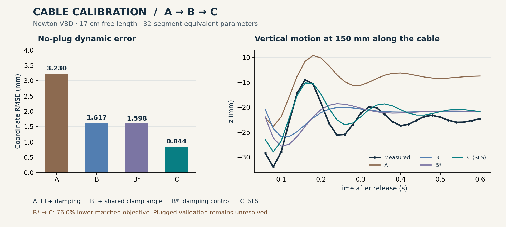

# TaskTuning

English · [简体中文](README.zh-CN.md)

Composable, evidence-based simulation parameter calibration for the Newton ecosystem.

The framework uses the `task_tuning` Python package and `task-tuning` CLI. The core remains simulator-independent; the cable example provides a Newton VBD adapter.

[GitHub](https://github.com/SamdianJ/TaskTuning) · [AtomGit](https://atomgit.com/SamiulJ/tasktuning) · [Contributing](CONTRIBUTING.md)

TaskTuning turns measured observations, a simulator adapter and a parameter space into one traceable `Tuning.run()`. It checks numerical accuracy and local identifiability, performs batched search, reloads the candidate, and validates before releasing an asset.

| Guide | Use it to |
|---|---|
| [User guide](docs/user-guide.md) | Install the package, compose a calibration, and inspect its outputs |
| [Framework overview](index.html) · [中文介绍](index_cn.html) | Explore the workflow and member responsibilities using the [local preview](docs/publishing-results.md) |
| [Cable case study](examples/cable_calibration/README.md) | Inspect measured evidence, archived results, and the pinned solver setup |
| [Calibration results](examples/index.html) · [Pipeline](pipeline.html) | Compare cable and plug results, view the task demo, and explore the calibration lifecycle |
| [Capabilities and limits](docs/implementation-status.md) | Check supported execution modes and what the diagnostics establish |
| [Codex skills](docs/codex-skills.md) | Configure calibration tasks with the bundled skills |

## Quick start

Python 3.11+; the core requires NumPy. Newton is **not** a core dependency.
Clone this repository from GitHub or AtomGit, then run the following commands from its root directory.

```bash
python -m venv .venv
source .venv/bin/activate
python -m pip install -e ".[cma,dev]"

# A complete CPU calibration using an independent analytical reference:
task-tuning demo --case sliding --optimizer grid --workspace workspace/sliding

# Two parameters, CMA-ES:
task-tuning demo --case oscillator --optimizer cma_es --workspace workspace/oscillator

# Re-score the real cable's archived results, without Newton or simulation:
python -m examples.cable_calibration.verify
```

Use `task-tuning inspect workspace/sliding/<run-id>` to read a result.
The demo CLI exits with code 0 only for an accepted result. See the [user guide](docs/user-guide.md) for installation, API usage, outputs and failure interpretation.

## Architecture

Ten members compose a Tuning instance; `RunState` is owned by Tuning.

| Member | Responsibility |
|---|---|
| Evidence | Observations, masks, scales, acquisition groups and train/validation split |
| Asset | Fresh environments, applied parameter readback, export/reload |
| Template | Fixed experimental conditions, discretization and numerical refinements |
| Parameters | Units, bounds, baselines and linear/log transforms |
| Rollout | Isolated trial × experiment × repeat execution |
| Evaluator | Batched NumPy losses, metrics, constraints and residual features |
| Optimizer | GridSearch / CMA-ES ask and tell |
| Decision | Sole continue/stop authority and all-phase budgets |
| Validator | Frozen-candidate training retest and validation |
| Play | Saved-trajectory comparison and USDA point animation |

```text
freeze inputs → baseline & numerical qualification → local sensitivity / SVD
→ Decision → ask → rollout → score → tell → stop
→ export/reload → training retest → validation → final numerical checks
→ release only if accepted
```

Numerical qualification defaults to explicitly declared refinements. `Template(qualification_mode="repeatability", refinements=())` instead checks repeated execution of the same fixed configuration. Reports record this narrower scope; repeatability does not establish timestep or discretization convergence.

A new case composes these objects. It does not replace `Tuning.run()`.
See the [class diagram](docs/tuning-class-diagram.md) and [design](docs/generic-calibration-workflow-design.md).

## Real example: cable calibration

[](examples/cable_calibration/reports/cable_calibration_en.html)

**[English HTML report](examples/cable_calibration/reports/cable_calibration_en.html)** · [Chinese report](examples/cable_calibration/reports/cable_calibration_zh.html)

The cable calibration was performed with **Newton VBD, using NVIDIA Warp on a CUDA GPU**. TaskTuning managed the calibration lifecycle and scored observations with PyTorch. The repository includes processed observations, 14 archived traces, stage-specific Newton adapters, portable configurations, and bilingual HTML reports.

| Stage | What changed | No-plug dynamic RMSE | Formal historical result |
|---|---|---:|---|
| A | Fit bending rigidity and damping | 3.230 mm | rejected_training |
| B | Add one shared mount-angle correction | 1.617 mm | rejected_validation |
| B* | Freeze static parameters; re-fit damping with distal weighting | 1.598 mm | rejected_validation |
| C | Replace viscous bending damping with SLS transient rigidity and relaxation time | 0.844 mm | rejected_validation |

A → B addresses a boundary hypothesis prompted by left/right residuals. It is not a controlled angle-only ablation. B* → C uses the same observations and objective; SLS reduces that objective by **76.0%**, but the plugged case still fails and remains numerically unqualified.

- [Case walkthrough and rerun instructions](examples/cable_calibration/README.md)
- [Downloadable English HTML](examples/cable_calibration/reports/cable_calibration_en.html) · [Downloadable Chinese HTML](examples/cable_calibration/reports/cable_calibration_zh.html) — download the reports or use the [local preview](docs/publishing-results.md).
- [Historical results](examples/cable_calibration/archive/) · [portable stage configurations](examples/cable_calibration/configs/)

### Which environment do I need?

| Task | Required environment |
|---|---|
| Generic synthetic demos | TaskTuning with NumPy; no Newton |
| Re-score archived cable traces | Core dependencies on CPU; no Newton or new simulation |
| Construct or rerun cable calibration | TaskTuning, SciPy, pinned Newton source and Warp; the recorded simulations used CUDA |
| Run stage C (SLS) | The same stack plus the bundled SLS adaptation applied to the pinned Newton base |

The historical cable environment used Python 3.12.13, Newton 1.6.0.dev0 at commit `d37f4d3d341ccce1e06a1dff21e9a054759b4855`, Warp 1.17.0, and an RTX 5070 Ti Laptop GPU. PyTorch 2.9.1+cpu handled scoring: **CPU PyTorch does not imply CPU Newton simulation**.

Installing `.[cable,cma]` does not install Newton or apply the SLS patch. Follow the [Newton environment and stage setup](examples/cable_calibration/README.md#5-construct-or-rerun-a-stage-with-newton) before using `--run`. Generic quick-start success and archive verification do not validate a new Newton environment. Raw MOV files, complete search histories and the full Newton source tree are not bundled.

## Codex skills

The five sibling directories in [codex-skills/](codex-skills/) form one coordinated configuration module:

- `standard-tuning`: intake, decisions, a shared specification and a real Tuning factory.
- `tuning-evidence`: Evidence / Evaluator / Validator.
- `tuning-environment`: Asset / Template / Rollout / Play.
- `tuning-search`: Parameters / Optimizer / Decision.
- `tuning-adapter`: minimal member adapters when existing implementations are insufficient.

See [installation and usage](docs/codex-skills.md). Skills do not install Python dependencies or create a second calibration loop.

## Development and limits

```bash
python -m pip install -e ".[cma,dev]"
python -m task_tuning.tests
python -m examples.cable_calibration.verify
ruff check task_tuning examples/cable_calibration/run.py examples/cable_calibration/verify.py
```

The core currently supports synchronous batches, threaded environment scheduling and NumPy scoring. Thread speedup depends on the backend. It does not provide process-level forced termination, distributed multi-GPU execution, automatic resume, Bayesian optimization or PBT.

Local SVD diagnostics are not confidence intervals or proofs of global identifiability. USDA output is a trajectory visualization, not a complete physical USD asset. **Search termination, training fit and accepted release are different outcomes.**

See [capabilities and limits](docs/implementation-status.md) and [skills usage](docs/tuning-skills-implementation.md).

Reports are bundled for [local viewing](docs/publishing-results.md). See [development and validation](CONTRIBUTING.md).

## Project provenance and licenses

TaskTuning retains the `task_tuning` package and `task-tuning` CLI while incorporating
runtime improvements from [Newton Calibration](https://github.com/newton-physics/newton-calibration)
at revision `9ed697ccc7be855e3078b78eb365921c9b7e5502`. This is the calibration
framework revision; the cable example has its own pinned Newton solver revision.
The [user guide](docs/user-guide.md#reload-saved-tasktuning-assets) covers compatibility
with saved TaskTuning assets.

Source code and original project documentation use [Apache-2.0](LICENSE).
The imported coding and review guidelines retain their [CC-BY-4.0](LICENSE-DOCS)
notices. See [NOTICE](NOTICE) for attribution and the bundled Newton patch license.

Maintainers can use the [cross-platform publishing guide](docs/repository-publishing.md)
to publish the same reviewed commit on GitHub and AtomGit. The guide also explains
which checks must be run separately from repository synchronization.
