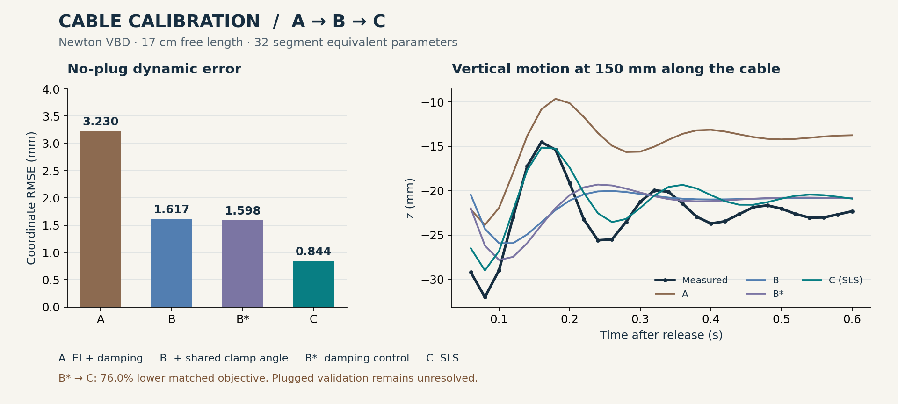

# TaskTuning

[English](README.md) · 简体中文

TaskTuning 是用于仿真参数标定的 Python 框架。将观测数据、仿真器适配器和待标定参数组合成一个 `Tuning` 实例，即可执行数值精度检查、参数搜索、候选模型重载和验证，并保存可追溯的结果。

Python 包名为 `task_tuning`，命令行为 `task-tuning`。核心使用 NumPy，可通过适配器接入不同仿真器；随附线缆案例使用 Newton VBD。

[GitHub](https://github.com/SamdianJ/TaskTuning) · [AtomGit](https://atomgit.com/SamiulJ/tasktuning) · [贡献指南](CONTRIBUTING.md)

| 入口 | 内容 |
|---|---|
| [使用指南](docs/user-guide.md) | 安装、组合标定成员、执行任务及读取输出 |
| [中文框架介绍](index_cn.html) · [English overview](index.html) | 流程、成员职责和实验说明，按[本地预览说明](docs/publishing-results.md)打开 |
| [线缆案例](examples/cable_calibration/README.md) | 实测数据、归档结果、分阶段模型与求解器配置 |
| [实验结果](examples/index.html) · [标定流程](pipeline.html) | 线缆与插头的标定前后对比、完整任务演示和流程说明 |
| [功能与限制](docs/implementation-status.md) | 执行模式、诊断结果的适用范围和当前限制 |
| [Codex skills](docs/codex-skills.md) | 使用随附技能配置标定任务 |

## 快速开始

需要 Python 3.11 或更高版本，核心依赖为 NumPy。以下基础示例在 CPU 上运行，不需要安装 Newton 或 PyTorch。

从 GitHub 或 AtomGit 克隆本仓库后，在仓库根目录执行：

```bash
python -m venv .venv
source .venv/bin/activate
python -m pip install -e ".[cma,dev]"

# 单参数滑动摩擦标定，使用独立解析参考数据
task-tuning demo --case sliding --optimizer grid --workspace workspace/sliding

# 双参数振子标定，使用 CMA-ES
task-tuning demo --case oscillator --optimizer cma_es --workspace workspace/oscillator

# 使用已保存轨迹复核线缆结果，不启动 Newton 仿真
python -m examples.cable_calibration.verify
```

上面的环境激活命令适用于 Linux/macOS。Windows PowerShell 使用 `.venv\Scripts\Activate.ps1`。

命令会打印任务目录和结果。使用 `task-tuning inspect workspace/sliding/<run-id>` 查看一次运行；将 `<run-id>` 替换为实际目录名。示例命令仅在结果为 `accepted` 时返回退出码 0。

## 标定流程

```text
定义观测、参数和实验条件
→ 检查基线与数值精度
→ 分析局部参数敏感性
→ 在固定数值设置下搜索物理参数
→ 导出并重载候选模型
→ 训练复测、验证与最终数值检查
→ 通过验收后发布标定资产
```

`Tuning.run()` 负责统一生命周期。十个成员分别表达观测、资产、模板、参数、执行、评分、搜索、停止决策、验证和回放；新案例通过组合或扩展成员接入。详见[类关系图](docs/tuning-class-diagram.md)和[流程设计](docs/generic-calibration-workflow-design.md)。

## 实测线缆案例

[](examples/cable_calibration/README.md)

案例使用静态形状和释放运动，逐步研究弯曲刚度、阻尼、安装角度和标准线性固体（SLS）模型。仓库包含处理后的观测、14 条归档轨迹、可移植配置和中英文报告。

| 阶段 | 模型变化 | 无插头动态坐标 RMSE | 历史正式结果 |
|---|---|---:|---|
| A | 拟合弯曲刚度和阻尼 | 3.230 mm | `rejected_training` |
| B | 加入共享安装角度修正 | 1.617 mm | `rejected_validation` |
| B* | 固定静态参数，重新拟合阻尼并增加远端权重 | 1.598 mm | `rejected_validation` |
| C | 使用 SLS 瞬态刚度与松弛时间 | 0.844 mm | `rejected_validation` |

B* 与 C 使用相同观测及目标函数，SLS 的拟合目标降低了 **76.0%**。这些数值来自拟合记录；带插头验证仍未通过，数值精度也未得到充分确认。A → B 同时包含重新拟合，不是只改变安装角度的受控消融实验。

[中文报告](examples/cable_calibration/reports/cable_calibration_zh.html) · [English report](examples/cable_calibration/reports/cable_calibration_en.html) · [历史运行记录](examples/cable_calibration/archive/)

下载仓库后可按[本地预览说明](docs/publishing-results.md)浏览 HTML 报告。复核归档评分不等于重新运行仿真或完成独立验证。

## 环境与适用范围

| 任务 | 环境要求 |
|---|---|
| 基础合成示例 | Python、NumPy；CMA-ES 需要 `cma` extra |
| 复核归档线缆结果 | 核心依赖，CPU 即可 |
| 重新运行线缆标定 | SciPy、指定 Newton 源码和 Warp；历史仿真使用 CUDA |
| 运行 Stage C | 在线缆环境中应用随附 SLS 补丁 |

线缆历史环境使用 Newton 1.6.0.dev0，固定提交为 `d37f4d3d341ccce1e06a1dff21e9a054759b4855`，Warp 为 1.17.0。历史评分使用 PyTorch，当前核心和归档复核使用 NumPy。请按照[线缆环境说明](examples/cable_calibration/README.md#5-construct-or-rerun-a-stage-with-newton)准备环境，普通安装不会自动安装 Newton 或应用补丁。

当前支持同步批次、线程环境调度、可选多候选环境及 NumPy 评分。实际加速取决于适配器；当前不提供进程级强制终止、分布式多 GPU 执行或自动恢复。局部 SVD 诊断不是置信区间，也不证明全局可辨识性；搜索结束、训练拟合良好和通过发布验收是不同结论。

## 开发与许可证

```bash
python -m pip install -e ".[cma,cable,dev]"
pre-commit run --all-files
python -m task_tuning.tests
python -m examples.cable_calibration.verify
python -m build
```

本版本在保留 TaskTuning 包名与命令行的基础上，同步了 [Newton Calibration](https://github.com/newton-physics/newton-calibration) 提交 `9ed697ccc7be855e3078b78eb365921c9b7e5502` 的框架改进。这个提交号描述标定框架的来源，与线缆所使用的 Newton 求解器提交号不同。

源代码和项目原创文档使用 [Apache-2.0](LICENSE)。导入的编码与评审指南保留 [CC-BY-4.0](LICENSE-DOCS) 声明，第三方署名见 [NOTICE](NOTICE)。参与开发请阅读[贡献指南](CONTRIBUTING.md)；维护两个平台的发布版本请参考[同步说明](docs/repository-publishing.md)。
