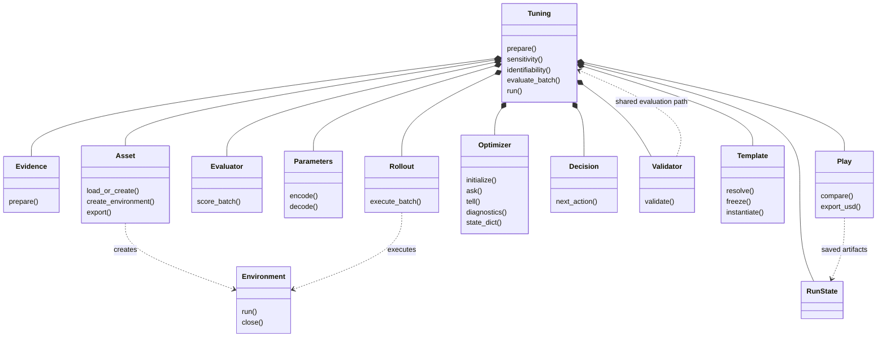

# Tuning object relationships

The diagram describes responsibility and ownership. Consult current Python signatures for executable APIs.



Sensitivity and identifiability are Tuning methods. Parameter definitions and mappings belong to Parameters. Optimizer supplies proposals, feedback state, and factual diagnostics; Decision alone decides continuation and stopping. Tuning owns writes to RunState.

## Data crossing member boundaries

| Record | Contents |
|---|---|
| Experiment | Acquisition identity, inputs, expected observations [T,D], physical times [T], scale, mask, weight, repeats |
| Trace / episode | Observations and times, applied parameters, execution status, trial/experiment/repeat identity |
| BatchResult | Search values [B,K], physical values [B,P], objectives [B], metrics [B,M], constraints [B,C], validity [B], episode references |
| Analysis reports | Perturbations, Jacobians/features, singular values, rank, combinations, fixed assumptions |
| Decision record | Authorized work or stop reason, budget accounting |
| Validation result | Frozen candidate metrics, pass/fail, scope and qualification |
| TuningResult | Parameters, termination_reason, acceptance, asset_path, run_directory |

Failed or missing results cannot become zero loss. Environment slots do not replace stable trial identity. Large traces may be stored separately with references.

## Lifecycle

```text
prepare evidence and asset
resolve/freeze template; baseline and numerical qualification
sensitivity -> identifiability -> freeze parameter mapping
Decision -> Optimizer.ask -> evaluate_batch -> Optimizer.tell -> Decision
stop -> export/reload best candidate
training retest -> Validator -> Play -> TuningResult
```

Decision also authorizes qualification, analysis, and finalization work. A run with no evaluable candidate skips candidate export and validation. Validation failure is not an implicit request to retrain.

Templates cannot change in place during search. Refinements use separate identities, and different experiments use previously declared conditions. See the [workflow design](generic-calibration-workflow-design.md) for full invariants and [implementation status](implementation-status.md) for limitations.
