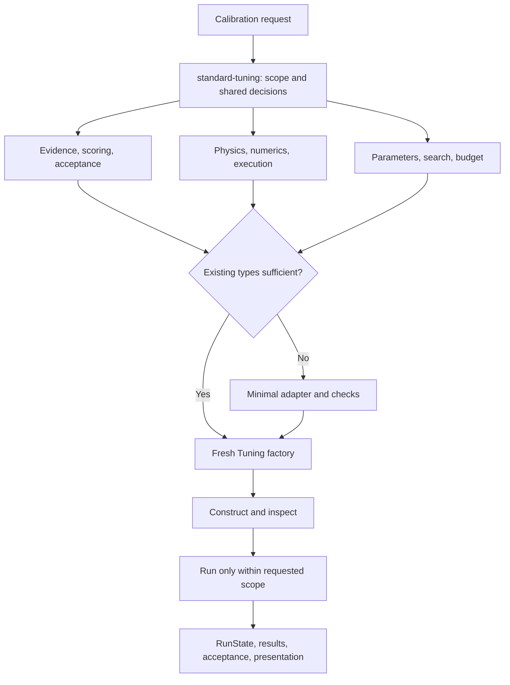

# Design of the Tuning skills module

See [usage and validation scope](tuning-skills-implementation.md) and [installation and usage](codex-skills.md).

## Purpose and boundary

The skills help turn a calibration request into explicit evidence, physical/numerical assumptions, scoring, parameters, search, and acceptance decisions, then construct a real Tuning instance. Skills guide configuration and call existing Python objects; they do not become another runtime or replace Tuning.run().

The cable case demonstrates uncertainty handling, not universal defaults for steps, segments, loss, thresholds, or optimizers. Success means real member types and justified configuration, visible unknowns, a runnable factory, preserved lifecycle ownership, and a clear distinction between configured, instantiated, and accepted.

## Five cooperating skills

| Skill | Responsibility | Deliverable |
|---|---|---|
| standard-tuning | Scope, intake, shared specification, assembly, handoff | Decision record, member list, fresh build_tuning() |
| tuning-evidence | Evidence / Evaluator / Validator | Observations, splits, scoring, acceptance |
| tuning-environment | Asset / Template / Rollout / Play | Physics/numerics, binding, execution, presentation |
| tuning-search | Parameters / Optimizer / Decision | Definitions, analysis, strategy, budgets |
| tuning-adapter | Missing member behavior only | Minimal implementation and contract checks |

These are related decision areas, not ten independent questionnaires. Child skills can be used separately. Multiple skills do not require multiple agents.

Configuration may iterate: observability affects model choice, and execution cost affects strategy. One shared TUNING-SPEC.md avoids divergent records.

## Intake rules

Inspect the user's intent, prior answers, data, asset, actual imports, source, and prior results before asking questions. Old settings are candidates for verification, not proof of correctness.

| Unknown | Handling |
|---|---|
| Established fact | Cite its source without repeating the question |
| Inspectable fact | Check code, metadata, or measurements |
| Intent/tradeoff | Ask with concise options and consequences |
| Technical choice | Propose and verify within scope |
| Missing physical fact | Measure, leave unresolved, or state a limited diagnostic assumption |

Usually ask one to three questions at the current dependency. User authorization persists. Agreement about a time step cannot substitute for convergence evidence. Low-impact presentation choices can be made directly.

Each decision records issue, conclusion/status, source, rationale/alternatives, affected members, verification, and invalidation. Separate confirmed intent from experimentally verified behavior. Recover across sessions from this record and reopen only invalidated decisions.

## Configuration principles

Evidence decisions establish observation meaning, correspondence, physical time, preprocessing, valid windows, acquisition groups, scale, masks, weights, metrics, and acceptance. Noise, normalization, and tolerance differ. Same-video slices are not independent holdout. Generic scoring supports squared error and cross entropy; other losses need real implementations and matching analysis/validation semantics.

Environment decisions separate physical quantities, experiment conditions, and numerics. Record derived bindings and solver readback. Qualify representative physics, time steps, space, iterations, isolation, and performance. Unknown stiffness or contact must not disappear into a numerical default. Specify transferable properties versus deployment-specific equivalent parameters.

Search decisions record physical bounds, units, baselines, transformations, coupling, and fixed uncertainty. Tuning owns analysis. Orthogonality does not prove identifiability. Choose an implemented optimizer with feasible full-batch costs; Decision owns all work/stopping authority. Budget final retest and validation, not only search.

Adapters are a last step after constructor configuration proves insufficient. Implement the smallest missing member behavior and test expected values, failures, identity, and lifecycle invariants. Never replace run() or add a parallel state manager.

## Handoff and scope

Provide actual member types and a factory returning a fresh Tuning. Import/construction must not simulate or create a run directory. Verify construction in a fresh process and attach specification/source/dependency identities to execution metadata.

prepare() performs simulations; build-only checks must not call it. Authorized calibration uses one fresh object's run() once. Deliver termination, training retest, qualification, export/reload, and acceptance separately. Validation failures may be useful diagnostic results but are not accepted assets.

Loss/mask/scale, physics/binding, or parameter changes invalidate related checks. Once holdout results guide revisions, mark development use and obtain new independent evidence for a generalization claim.

## Acceptance

See [behavior scenarios](../codex-skills/standard-tuning/references/acceptance-scenarios.md). Format validation, manual review, synthetic handoff execution, and independent agent behavior evaluation are different checks. Installation or a successful generic demo does not establish real-cable accuracy.
